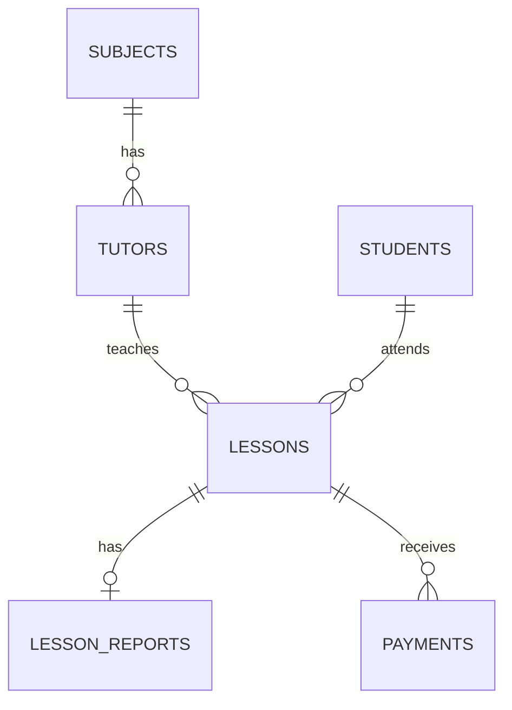

# Conceptual ERD — Tutoring Mini

Business rule: every Completed lesson must have exactly one report, whereas Pending/Cancelled lessons have no reports. This cross-table rule is checked in the seed validations. A report carries the confirmed fee; one lesson may have multiple partial payments.

The editable Chen-style source is [ERD_Source.erdplus](ERD_Source.erdplus); the detailed relational diagram is [Relational_Schema.svg](Relational_Schema.svg).
